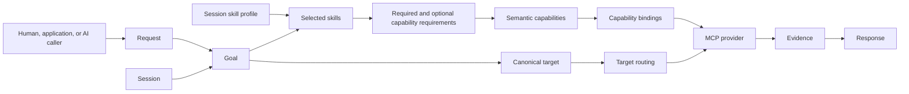
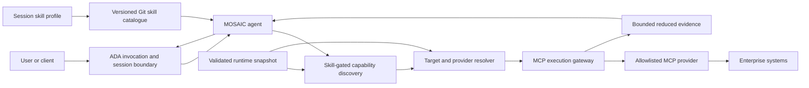
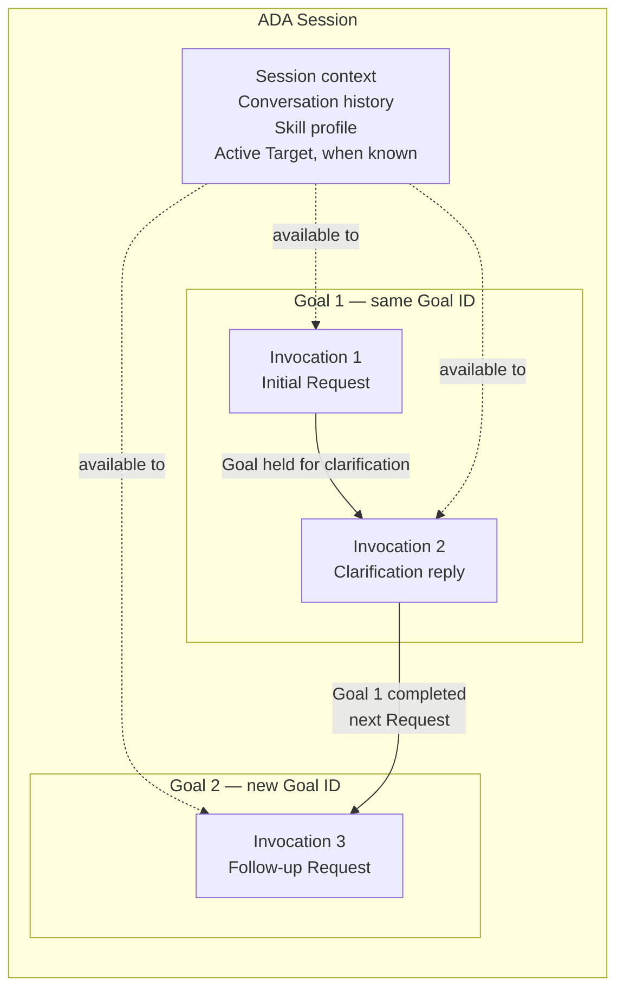
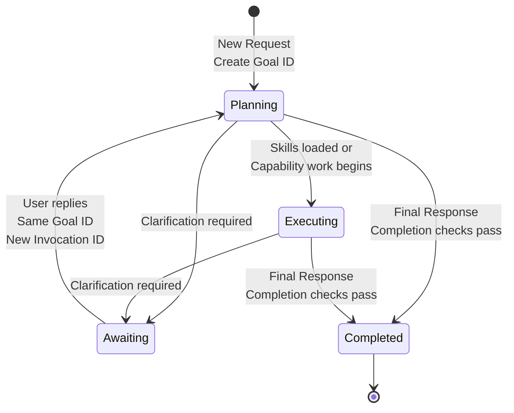

# MOSAIC

**Make the organisation's best operational expertise available wherever it is
needed.**

MOSAIC is an investment in organisational capacity. It turns specialist
knowledge from a scarce, person-dependent resource into a governed capability
that can be reused across teams, systems, and business services.

For a user, the promise is simple: start with the problem, not with the tool.
Instead of finding the right dashboard, learning a provider query language,
locating a runbook, and waiting for the right specialist, the user can ask for
the outcome they need and receive a consistent, evidence-based response.

For the organisation, this creates a more fundamental shift. Experts can
capture what good investigation looks like once. Platform teams can make
trusted operational evidence available once. That combined value can then be
reused by many teams without multiplying integrations, duplicating guidance,
or making every user an expert in the underlying technology.

MOSAIC is therefore not another support chatbot. It is the beginning of a
shared operational intelligence layer: a place where knowledge, evidence, and
governance come together to help people make better decisions, faster.

The MVP makes that future visible and useful now. Its initial read-only
operational scenarios demonstrate the value with real platform evidence while
establishing a foundation that can expand across technologies, teams, and
business processes.

## Why MOSAIC matters

Operational expertise is enormously valuable, but traditional support models
scale it linearly: more demand requires more specialist time. Knowledge remains
distributed across individuals, runbooks, team conventions, and tools, while
users lose time navigating organisational and technical boundaries before
investigation can begin.

MOSAIC is intended to break that dependency.

| Organisational value | What changes |
| --- | --- |
| **More capacity from existing expertise** | Specialists spend less time repeatedly applying routine knowledge and more time on novel, high-value problems. |
| **Shorter time to understanding** | Users reach relevant evidence without first navigating multiple teams, interfaces, and provider-specific languages. |
| **Consistent quality at scale** | Every team can begin from the same approved investigative baseline, regardless of individual experience or time pressure. |
| **Knowledge that survives organisational change** | Important operational practice becomes an owned, reusable asset rather than remaining in individual memory. |
| **Lower cost of integration** | A platform or evidence source can support many use cases without a bespoke point-to-point assistant integration for each one. |
| **Easier self-service** | People can benefit from established expertise while they are still learning the organisation's systems and operating model. |
| **Greater confidence in enterprise AI** | AI adoption can expand within visible operational and governance boundaries instead of relying on unrestricted model behaviour. |
| **Freedom to evolve technology choices** | Operational knowledge remains useful when providers, endpoints, models, or presentation channels change. |

The long-term result is a compounding internal capability. Every approved area
of expertise and every governed integration increases what the organisation
can make available through the same experience. Value grows through reuse,
not through rebuilding the agent for each platform or use case.

## The challenge MOSAIC solves

A general-purpose AI assistant can reason about a problem, but it does not
inherently know:

- which operational procedure is approved;
- which systems a particular user or workspace may access;
- how a business-level request maps to a concrete provider tool;
- which environment the user means;
- how to constrain large or sensitive provider responses; or
- how to distinguish evidence from a plausible-sounding assumption.

MOSAIC introduces governed layers between the language model and operational
systems. The model reasons in terms of approved outcomes while trusted runtime
code controls provider selection, arguments, routing, limits, and execution.

```text
User goal
   ↓
Authorised skill (approved procedure)
   ↓
Semantic capability (required outcome)
   ↓
Validated target and provider binding
   ↓
Bounded read-only MCP request
   ↓
Reduced evidence and a qualified response
```

This separation makes investigations repeatable and reviewable, allows a skill
to survive changes in its underlying provider, and gives the organisation a
safer route to operational AI than exposing raw tools or endpoints directly to
the model.

### What makes MOSAIC different

- **Knowledge is a managed product.** Skills are reviewable, versioned assets,
  not prompt fragments hidden inside application code.
- **Intent is separated from implementation.** Skills request semantic
  capabilities; trusted bindings decide which provider and tool can deliver
  them.
- **Context is governed.** Sessions discover only authorised skills, goals see
  only skill-declared capabilities, and target selection never expands access.
- **Evidence is bounded.** Provider results are constrained and reduced before
  entering the model context.
- **The platform is composable.** Procedural skills, operational providers,
  and output formats can evolve independently around stable contracts.

## Core concepts

The concepts used by MOSAIC fall into three groups: the live interaction,
governed organisational knowledge, and the configuration that connects MOSAIC
to operational systems.

### Interaction and runtime concepts

| Concept | Meaning |
| --- | --- |
| **Request** | A directive submitted by a human user, client application, or upstream AI agent. |
| **Goal** | The unit of work MOSAIC creates from a request. It triggers the controlled sequence needed to satisfy the requested outcome: skill discovery, skill selection, capability discovery, target resolution, evidence collection, and response generation. A clarification reply continues the same goal; a later follow-up starts a new one. |
| **Session** | The continuing interaction context across multiple goals. It retains the authorised skill profile and may retain an active target, but capability outcomes from a completed goal cannot satisfy a later goal. |
| **Evidence** | Bounded information returned by an approved capability and used to support the response. |
| **Response** | The result returned for the goal, including relevant conclusions, uncertainty, and material evidence limitations. |

### Governed knowledge concepts

| Concept | Meaning |
| --- | --- |
| **Skill** | A versioned package of organisational knowledge. `SKILL.md` contains the approved instructions describing how to approach a task or present its result. `mosaic.yaml` contains the governed metadata, including the skill's required and optional capability requirements. Neither file contains provider endpoints or credentials. |
| **Skill profile** | The set of skills a session is authorised to discover and use. A profile contains skills, not targets or provider endpoints. |
| **Capability requirement** | A semantic capability referenced by a skill in `mosaic.yaml`. A required capability must reach a terminal outcome before the goal can complete. An optional capability may be used when it materially helps satisfy the goal. |
| **Capability** | A provider-neutral outcome MOSAIC can obtain, such as `kubernetes.pods.running.count`. |

### Integration configuration concepts

| Concept | Meaning |
| --- | --- |
| **Target** | The stable, user-meaningful identity of a real operational environment or platform instance, such as `openshift/uk-dev`. A target remains stable even when its provider endpoint changes. |
| **Provider** | A configured MCP connection, including its concrete endpoint and exact allowlist of callable tools. |
| **Capability binding** | The governed mapping between a semantic **capability** and a provider type and tool, including argument preparation, result extraction, and safety limits. |
| **Routing** | The governed rule that determines which concrete provider instance can serve a capability for a canonical target. Routing may use a dedicated endpoint for one target or a protected selector on an endpoint shared by several targets. Routing chooses where an already-authorised capability executes; it does not grant additional capabilities. |
| **Integration manifest** | The versioned deployment configuration containing the available targets, providers, capabilities, capability bindings, and routing rules. |

Users add skills to their profile; they do not add or select targets as profile
configuration. For each goal, the relevant loaded skills determine which
capabilities MOSAIC may expose. The capability bindings and provider routing
then determine the compatible target scope. The user identifies the intended
environment only through the conversation, either in the original request or
in response to clarification, and MOSAIC resolves that name to a canonical
target. An existing session target may be reused when it remains compatible.

In short: skills determine what MOSAIC is permitted to investigate. Capability
bindings determine how the evidence can be obtained. Routing determines which
provider serves the environment identified in the conversation. Resolving a
target can never grant capabilities beyond those declared by the loaded,
authorised skills.



## How MOSAIC works

### High-level architecture

For each new goal, MOSAIC follows a progressive-disclosure flow:

1. The runtime exposes a bounded summary of the skills authorised for the
   current session.
2. The model selects and loads the complete relevant skill set once.
3. MOSAIC exposes only the semantic capabilities declared by those skills.
4. When required, a user-supplied target name or alias is resolved to a
   configured canonical target.
5. Trusted runtime code chooses the compatible provider, maps semantic inputs
   to concrete tool arguments, and injects protected routing values.
6. The MCP result is checked and reduced according to its configured result
   binding before evidence reaches the model.
7. Required capability outcomes are tracked for the goal. MOSAIC prevents a
   final answer while a required capability remains incomplete.
8. An output skill may constrain the final answer, for example as JSON or as a
   plain-language stakeholder summary.



Provider endpoints, concrete tool names, fixed arguments, credentials, and
provider-specific routing values remain outside the skill text and model
prompt.

### Interaction workflows

MOSAIC separates the continuing conversation from the individual units of work
performed within it. A Goal is not a separate process or conversation: it is
the governed unit of work MOSAIC uses to satisfy one requested outcome.

| Concept | Meaning |
| --- | --- |
| **Session** | The longer-lived ADA conversation. It retains conversation history, the authorised Skill profile and, when one has been established, the active Target. |
| **Invocation** | One execution of the MOSAIC agent, normally triggered by a user message. |
| **Goal** | One complete unit of work, from the initial Request until MOSAIC produces a final Response. A Goal may span multiple Invocations when clarification is required. |
| **Goal state** | The trusted working state MOSAIC retains while completing a Goal, including its phase, selected Skills, declared Capabilities, required outcomes, pinned Target and any clarification question. |

#### How the concepts fit together



A Session may contain many Goals. Most Goals complete within one Invocation, but
a Goal can span multiple Invocations when MOSAIC needs additional information
from the user.

Only the active Goal's orchestration state is retained as working state.
Completed Requests and Responses remain available through the Session's
conversation history, but their Capability outcomes cannot satisfy a later
Goal.

#### Goal lifecycle



#### How a Goal starts

A new Goal starts when a Request arrives and the Session has no current Goal,
or its previous Goal has completed.

MOSAIC then:

1. Creates a new Goal ID and associates the current Invocation with it.
2. Resolves the Session's trusted Skill profile.
3. Discovers the authorised Skill metadata available to that profile.
4. Gives the model the Request, relevant conversation context and bounded Skill
   summaries.
5. Allows the model either to answer using general knowledge or to select and
   load the complete relevant Skill batch.
6. Exposes only the Capabilities declared by the loaded Skills.
7. Collects governed Evidence when external information is required.
8. Produces one final Response for the complete Goal.

Skill discovery occurs for every new Goal, even when the model subsequently
determines that no specialised Skill is relevant. This applies the same
governed process consistently without preventing general-knowledge responses.

#### How a Goal is held

A Goal is held when it cannot continue safely without additional information,
such as a namespace, queue name or Target.

MOSAIC records:

- that the Goal is awaiting clarification;
- the clarification question;
- the selected Skills;
- the declared and discovered Capabilities;
- any completed required outcomes; and
- the Goal's pinned Target, if one has been resolved.

The current Invocation then ends and the question is returned to the user.
There is no agent process left running in the background: the Goal is held as
trusted state within the ADA Session.

When the user replies, ADA starts a new Invocation. MOSAIC resumes the same
Goal by:

- retaining the existing Goal ID;
- assigning the new Invocation ID;
- retaining the previously loaded Skill batch;
- retaining the Capability and Target state;
- retaining any completed required outcomes; and
- clearing the stored clarification question.

Skill discovery and Skill loading are therefore not repeated for a
clarification reply.

At present, any new message received while a Goal is awaiting clarification is
treated as the answer to that clarification. Reliably detecting that the user
has abandoned the pending Goal and started a different one is planned work.

#### How a Goal ends

The model determines when it has enough information to produce the final
Response, but MOSAIC decides whether the Goal is structurally allowed to end.

Before accepting the Response, MOSAIC confirms that:

- authorised Skill discovery has completed;
- the Goal is not awaiting clarification; and
- every required Capability has reached a terminal outcome.

If the model attempts to respond while a required Capability remains pending,
MOSAIC continues execution internally. The user does not receive the premature
Response.

A terminal outcome does not necessarily mean success. A required Capability
may have:

- succeeded;
- been unavailable;
- produced Evidence that exceeded a governed limit;
- failed;
- timed out; or
- been unavailable because a configured safety limit was reached.

These outcomes allow the Goal to end because no required work remains pending,
but any resulting limitation must be explained in the final Response.

Optional Capabilities may improve the result but do not prevent completion.

For a general-knowledge Goal, Skill discovery still occurs, but no Skill or
Capability execution may be required. The Goal completes when the model
produces its final Response.

MOSAIC therefore enforces **structural completion**: the model decides that the
requested outcome has been addressed, while the runtime ensures that all
required workflow and Evidence obligations have been resolved.

#### What happens after completion

The completed Goal remains recorded as completed until the next Request
arrives. It is not continued or reopened by an ordinary follow-up.

The next Request creates a new Goal with:

- a new Goal ID;
- fresh Skill discovery;
- a new Skill selection;
- new Capability candidates; and
- fresh required-outcome tracking.

Some Session-level context remains available:

- previous conversation and Responses;
- the Session's authorised Skill profile; and
- a compatible active Target, when one has already been established.

Previous Capability outcomes cannot satisfy the new Goal. If the follow-up asks
about the current state of an external system, MOSAIC must gather fresh
Evidence.

Changing the Target also requires new target-bound Evidence. MOSAIC never
carries execution outcomes from a previous Target into the new Goal.

#### Why Goal state is isolated

MOSAIC deliberately separates **conversational continuity** from **operational
trust**.

Conversation history may cross Goal boundaries so that follow-up questions
remain natural. Trusted operational state—such as selected Skills, Capability
candidates and completed Capability outcomes—does not cross those boundaries.

| Decision | Rationale |
| --- | --- |
| A follow-up after completion receives a new Goal ID. | It establishes a clear boundary between the completed outcome and the new Request. This makes execution, Evidence and limitations attributable to the correct unit of work. |
| Skills and Capabilities are selected again for each new Goal. | A follow-up may require a different procedure, output format or system access. Reusing the previous selection could expose irrelevant Capabilities or omit newly relevant Skills. |
| Capability outcomes cannot satisfy a later Goal. | Previous Evidence may be stale, scoped to different inputs or collected for a different question. A successful earlier execution does not prove the current state of an operational system. |
| A clarification reply retains the same Goal. | The requested outcome has not changed; MOSAIC is only obtaining information needed to complete it. Retaining the Goal avoids repeating completed work. |
| The Session Target may be reused, but each Goal pins its own Target. | Reuse makes conversation convenient, while Goal-level pinning prevents Evidence from different environments being combined accidentally. |
| Conversation history remains available. | The model can explain previous findings and understand references such as “that probe” or “the earlier error” without treating the previous investigation as current Evidence. |
| The Skill profile remains Session-scoped. | The profile represents what the Session is authorised to use, while each Goal independently selects the relevant subset. |

This boundary prevents stale Evidence, Target confusion, unrelated Capability
state and previous failures from leaking into a new unit of work.

> Conversation context may cross Goal boundaries; authority, execution state
> and Evidence do not.

#### Example: asking about a completed result

Suppose MOSAIC reports that a deployment has unavailable replicas because its
readiness probe is failing. The user can continue in the same Session and ask:

> What is a readiness probe, and what does that mean for users?

This creates a new Goal, but the previous Response remains available as
conversation context. MOSAIC can explain the unfamiliar term and its likely
impact without repeating the investigation.

If the user instead asks:

> Is the readiness probe still failing?

The new Goal must use the relevant Skills and collect fresh Evidence. The
earlier investigation cannot prove the system's current state.

## Example use cases

### Container-platform investigation

A user can ask MOSAIC to investigate an unhealthy workload, a stalled rollout,
an OpenShift ingress problem, a service-connectivity failure, or a storage
failure. A relevant skill directs the investigation while capabilities obtain
only the necessary pod, controller, event, detail, log, network, or storage
evidence.

Example:

> Investigate why the payments deployment is not ready in namespace
> `payments-prod` on the UK development OpenShift cluster over the last 30
> minutes.

### Bounded workload inventory

MOSAIC can answer focused inventory questions without automatically expanding
them into a full diagnostic exercise.

Example:

> How many running pods are in namespace `order-api`?

The capability can require a namespace, apply a fixed running-state filter,
count the returned collection, and expose only the scope and count to the
model.

### Observability correlation

A time-bounded observability skill can quantify HTTP latency, response classes,
connection errors, resource pressure, or restarts and correlate them with
platform evidence. Provider query languages remain hidden in the capability
binding.

### Governed runbook matching

A database request can be mapped to an approved, versioned runbook through a
governed retrieval provider. The intended use case selects and explains the
runbook; it does not execute the procedure.

### Different outputs from the same evidence

Procedural skills and output skills can be selected together. The same
investigation can produce schema-conformant JSON for automation or a concise
plain-language summary for service owners and executives.

## Configuration overview

MOSAIC configuration covers deployment settings, workspace access and choices
users make in their own workspace.

| Configuration area | Owner | Purpose |
| --- | --- | --- |
| **MOSAIC platform configuration** | MOSAIC platform administrators | Connect and operate the MOSAIC runtime, select its approved model, locate its governed configuration sources, and enforce deployment-wide limits. |
| **Workspace and access governance** | Tenant, workspace, and access administrators | Determine which approved **Skills** and **Targets** are available to a tenant, workspace, team, or role, and govern Skill profiles, quotas, and access policy. The current MVP implements only a temporary subset of this boundary. |
| **User and Session configuration** | Users | Select published **Skills** for their own workspace through the pilot API and identify the intended **Target** through conversation. The GUI editor is a separate follow-up. |

### MOSAIC platform configuration

MOSAIC platform administrators manage these deployment settings.

#### Required MCP transport setting

> **Required for the current deployment:** set
> `GOOGLE_API_USE_CLIENT_CERTIFICATE=false` before starting MOSAIC.

| Environment variable | Required value | Purpose |
| --- | --- | --- |
| `GOOGLE_API_USE_CLIENT_CERTIFICATE` | `false` | Disables Google ADK's automatic client-certificate mTLS probe for the current MCP endpoints, which do not use client-certificate authentication. |

Google ADK 2.5.0 attempts to configure an mTLS channel whenever it creates an
HTTP MCP session, including for a plain `http://` endpoint. ADA's
`MCPHeaderProvider` also generates a new `x-uuid` for each header-provider
call. Because ADK includes the complete header set in its session identity,
tool discovery and execution may create separate sessions and repeat the mTLS
probe. On slower hosts this added latency can exceed MOSAIC's 30-second MCP
timeout before the actual tool call completes.

The current MCP providers do not require client certificates, so explicitly
disabling this probe is the correct deployment configuration and avoids the
unnecessary delay. This setting is process-wide. If a future deployment needs
client-certificate mTLS for any MCP provider, do not disable it globally;
introduce a provider-scoped transport configuration instead.

#### Shared outbound HTTPS trust

Set `SSL_CERT_FILE` in the backend process environment to the path of the
approved PEM CA bundle. Mount the bundle separately from the image and keep
deployment-specific paths and certificate material outside public Git. The same
bundle can validate multiple approved HTTPS endpoints; each endpoint must still
present a certificate matching its hostname and the required intermediate chain.

Target-environment inspection reported no explicit TLS bypass in the configured
GeminiViaAccessLayer or MCP Streamable HTTP interfaces. Their expected default
HTTPX/OpenSSL behaviour uses this bundle with certificate and hostname
verification enabled. Confirm environment trust and actual transport construction
on SDK upgrades; source inspection alone does not establish live TLS verification.
Test model access, MCP discovery and tool execution over HTTPS. A CA bundle does
not protect a plain HTTP endpoint.

`GOOGLE_API_USE_CLIENT_CERTIFICATE=false` controls the separate client-certificate
probe, not server certificate verification. Custom clients must retain verified
TLS and environment trust or use a verified SSL context with the approved bundle.
Do not use `verify=False` to resolve certificate failures.

The Git catalogue transport explicitly enables certificate verification for
initial clones and cached fetches. It passes `SSL_CERT_FILE` to Dulwich's
`http.sslCAInfo` setting. If unset, Dulwich uses its standard trusted CA defaults.
If set, the file must be readable and contain valid PEM CA certificates; an empty,
missing or invalid configured bundle fails configuration validation. There is no
fallback to disabled verification. Remote plain HTTP Git URLs are rejected.

One PEM bundle can contain CA certificates for multiple independent trust chains,
including development and production CAs. The `.pem` or `.cer` extension is not
significant; the contents must be PEM. Choose the approved trust scope for each
deployment and include any public CAs needed by its other HTTPS clients. This
bundle is a trust input, not a server certificate or private-key file.

Set `SSL_CERT_FILE` before starting the backend and restart it after changing the
path or bundle. No new MOSAIC-specific CA environment variable is required. The
bundle path and Bearer token are not written to the bare Git cache. Existing
last-valid-snapshot recovery remains: a failed verified fetch may retain the
previous validated snapshot, but cannot activate new remote content or retry
without verification. A configured invalid bundle prevents initialisation even
when a cached catalogue exists.

#### Approved model access

| Environment variable | Purpose |
| --- | --- |
| `LLM_PROXY_URL` | Base URL of the organisation's AI Access Layer. |
| `LLM_MODEL` | Model selected through that access layer. |
| `AGENT_IDENTIFIER` | Trusted MOSAIC agent identity sent as `x-agent-id`. This is not end-user identity. |

#### Skills and capability configuration

The Git repository supplies both `skills/` and
`config/capability-runtime-snapshot.json`. Startup validates both from the same
commit, including required and optional capability references in each Skill.
The catalogue is activated only when the complete release validates. If a fetch
or candidate validation fails, the existing cache may supply the previous valid
pair. Without a valid release, startup fails.

Pin `MOSAIC_SKILLS_REPOSITORY_REVISION` to the approved commit for a deployment.
Restart the backend to activate a new release. To roll back, select the previous
commit and restart. The Git-backed runtime ignores
`MOSAIC_CAPABILITY_RUNTIME_SNAPSHOT_PATH`; it needs no separate capability file
mount. Endpoint URLs come from the manifest. Credentials remain runtime inputs.

| Environment variable | Purpose |
| --- | --- |
| `MOSAIC_SKILLS_REPOSITORY_URL` | URL of the Git repository containing Skills and the capability manifest. |
| `MOSAIC_SKILLS_REPOSITORY_REVISION` | Branch, tag, or revision to activate; defaults to `main`. |
| `MOSAIC_SKILLS_REPOSITORY_CACHE_PATH` | Deployment-local bare Git cache. |
| `MOSAIC_SKILLS_REPOSITORY_ACCESS_TOKEN` | Repository Bearer token; required and never stored in the active Skill catalogue or Git cache. |
| `MOSAIC_SKILLS_SYNCHRONIZATION_TIMEOUT_SECONDS` | Maximum controlled synchronisation time. |

Platform administrators also configure the active **Integration manifest** and
deployment-wide safety limits. The existing environment-variable names retain
`SNAPSHOT` because they are part of the current implementation contract; the
user-facing concept is the Integration manifest.

| Environment variable | Purpose |
| --- | --- |
| `MOSAIC_CAPABILITY_RUNTIME_SNAPSHOT_PATH` | Standalone file-loader setting. Ignored by the Git-backed agent. |
| `MOSAIC_CAPABILITY_RUNTIME_SNAPSHOT_MAXIMUM_BYTES` | Maximum accepted Integration manifest size in bytes. It defaults to `2000000` bytes and may be set to a positive value up to the current implementation-enforced maximum of `10000000` bytes. |
| `MOSAIC_CAPABILITY_RESULT_MAXIMUM_RESPONSE_CHARACTERS` | Deployment-wide ceiling for one encoded Provider response. |
| `MOSAIC_CAPABILITY_RESULT_MAXIMUM_COLLECTION_ITEMS` | Deployment-wide ceiling for one selected Evidence collection. |
| `MOSAIC_CAPABILITIES_MAXIMUM_CANDIDATE_COUNT` | Maximum number of skill-declared Capabilities exposed for one Goal. |
| `MOSAIC_CAPABILITIES_MAXIMUM_METADATA_CHARACTERS` | Maximum serialised Capability metadata exposed for one Goal. |
| `MOSAIC_SKILLS_MAXIMUM_ENABLED_SKILL_COUNT` | Maximum number of Skills authorised by one Skill profile. |
| `MOSAIC_SKILLS_MAXIMUM_DISCOVERY_METADATA_CHARACTERS` | Maximum Skill metadata exposed during discovery. |
| `MOSAIC_SKILLS_MAXIMUM_LOADED_SKILL_COUNT` | Maximum Skills loaded for one Goal. |
| `MOSAIC_SKILLS_MAXIMUM_LOADED_SKILL_CHARACTERS` | Maximum complete Skill content loaded for one Goal. |

### Workspace and access governance

This boundary will determine which approved Skills, Targets, and platform
resources are available within a tenant or workspace and how that access is
assigned to teams, roles, and users. It is expected to govern Skill profiles,
Target visibility, quotas, and access policy through the future identity,
tenancy, RBAC, and frontend services.

#### Separate GUI browser access

The independent Dash/Bootstrap GUI is in `gui/`. Copy that folder unchanged to
its own repository if required; it has its own package, pinned dependencies,
entrypoint, assets and tests. See [the GUI README](gui/README.md) for installation and private
logo configuration. The GUI does not import the orchestrator or access its
databases, and it is not mounted into the backend.

Configure `MOSAIC_BROWSER_ALLOWED_ORIGINS` as a JSON array of exact trusted GUI
origins. The default is `[]`: no browser-origin access is enabled. For a GUI
running locally on port 8050, use:

```sh
export MOSAIC_BROWSER_ALLOWED_ORIGINS='["http://127.0.0.1:8050"]'
```

Use that same hostname consistently for GUI and backend locally; `localhost`
and `127.0.0.1` are different origins. Origins include scheme and optional port,
with no trailing slash or path. HTTPS is required except for explicit loopback
HTTP origins. Deployment addresses belong in environment configuration, not code.

The GUI makes requests directly to the separate backend with browser credentials
included. CORS permits GET and POST with Content-Type and Authorization headers,
credentials and the exact configured origin, never a wildcard. It exposes
X-Correlation-ID to the browser and handles preflight before user authentication.
Only public MOSAIC routes are available; this does not expose private ADA routes.

Origin checks additionally reject unapproved, null and duplicate origins on API
requests, including sign-in and sign-out. Cookie-authenticated writes without
an approved Origin are forbidden; include that header when testing cookie writes
with curl. Originless bearer-token and administrator CLI calls remain supported.
CORS does not grant identity or ownership permissions. Keep the authentication
cookie host-only, HttpOnly and SameSite=Strict, with Secure enabled in deployment.
The deployed GUI and backend must use HTTPS under the same parent domain for
that cookie policy; local HTTP requires the existing explicit local auth mode.

#### Pilot workspace Skill binding

The authenticated, read-only `GET /api/v1/workspace` endpoint returns the
signed-in user, workspace identifier and assignment version, plus current
assigned Skill labels, descriptions, kinds and catalogue group paths. It
accepts no ownership selector and returns `Cache-Control: no-store`.
Missing or empty workspaces return an empty Skill list. Saved IDs absent from
the active catalogue are returned to their owner in `withdrawn_skill_ids`.
Executable instructions, output schemas, capability
declarations and credentials are never included.

This endpoint describes current workspace assignments, not the immutable Skill
snapshot of an already-active Goal. The independent GUI can use it after sign-in
to populate its identity and read-only Skills panel.

For the pilot, all Skills in the active published catalogue are public to
signed-in users. `GET /api/v1/skills` returns their display metadata as an array.
`GET /api/v1/skills/catalogue` returns paged domains, functions within a domain,
or Skills within a function. Use `q` for catalogue-wide search and `next_offset`
to request another page.
`POST /api/v1/workspace/skills` replaces the authenticated user's selection and
returns the saved workspace summary. Send `expected_version` from the workspace
read and `skill_ids` as the complete list of selected IDs. An empty list clears
the selection. A withdrawn ID can be retained only if it is already in the
authenticated user's workspace. New IDs must be in the published catalogue.
A stale version returns
HTTP 409 so the client can reload the latest workspace before saving again.
Cookie-authenticated writes require an approved browser origin.

The normal agent obtains its active Skill set from the authenticated user's
workspace in `mosaic.db`. Administrators can also update the selection through
`mosaic-admin`. The workspace version protects updates from both paths.

For each new Goal, MOSAIC verifies the enabled user and owned public
conversation, then binds an immutable snapshot of the workspace's assigned
Skills from the active catalogue. The snapshot remains unchanged throughout
that Goal, including clarification. Assignment changes apply to the next Goal,
without requiring a runtime restart. Missing or empty workspaces grant no
Skills; unknown or withdrawn catalogue references cannot be loaded.

The existing discovery and loading limit environment variables remain in use.
Deployment profile variables (`MOSAIC_SKILLS_PROFILES`,
`MOSAIC_SKILLS_DEFAULT_PROFILE_ID`, and
`MOSAIC_SKILLS_SESSION_PROFILE_ASSIGNMENTS`) no longer authorise the normal
agent. The legacy resolver remains available only when explicitly composed
separately; it is never a fallback for workspace binding. Direct ADK dev-UI
sessions without an enabled owner and public conversation metadata cannot bind
workspace Skills. Use the authenticated public conversation API for the pilot.

An already-started Goal without a valid workspace binding fails closed rather
than receiving new access midway through execution. Use a fresh conversation
when moving an unfinished legacy session to this runtime.

The MVP does not yet provide workspace-scoped Target visibility. Compatible
Targets are derived from the Capabilities declared by loaded Skills and the
available Capability bindings and Routing in the Integration manifest.

### User and Session configuration

The intended user-facing configuration is the **Skill profile**: a selection
of Skills drawn from those already authorised through Workspace and access
governance. A user may add or remove permitted Skills without configuring the
underlying integrations.

Users do not configure Providers, Capability bindings, or Routing. They
identify the intended Target through the conversation, either in the original
Request or in response to clarification, and MOSAIC may reuse a compatible
Target within the same Session.

The pilot workspace API supports self-service selection from the active
published catalogue. The GUI editor is a separate follow-up.

## The capability runtime snapshot

The Git-backed agent loads `config/capability-runtime-snapshot.json` from the
same commit as the Skills. The standalone file loader continues to accept an
absolute `MOSAIC_CAPABILITY_RUNTIME_SNAPSHOT_PATH` for explicit file-loading
callers. The complete file is validated at startup and rejected if it is
missing, malformed, internally inconsistent, or references an unapproved
provider/tool combination. The file is also rejected when it exceeds
`MOSAIC_CAPABILITY_RUNTIME_SNAPSHOT_MAXIMUM_BYTES`. This limit defaults to
`2000000` bytes (2 MB, approximately 1.91 MiB) and may be configured to a
positive value no greater than the current implementation-enforced maximum of
`10000000` bytes (10 MB, approximately 9.54 MiB). This upper bound is a MOSAIC
application guardrail rather than an absolute filesystem or JSON limitation;
changing it requires a code change. The size check occurs before MOSAIC reads
and parses the JSON file.

The current document structure is:

```json
{
  "schema_version": 3,
  "snapshot_id": "my-platform-2026-09-24",
  "targets": [],
  "providers": [],
  "capabilities": []
}
```

An end-to-end target-independent example is available at
[`config/capability-runtime-snapshot.example.json`](config/capability-runtime-snapshot.example.json).

### 1. Identify the snapshot

`schema_version` must currently be `3`. `snapshot_id` is a deployment-owned
immutable identifier used to distinguish published configurations.

### 2. Define targets

A target is a user-facing identity for a deployed platform instance:

```json
{
  "id": "openshift/uk-dev",
  "display_name": "UK development OpenShift",
  "aliases": ["uk-dev", "cluster1"]
}
```

Target IDs use `vertical/target`. IDs are globally unique; aliases are
case-insensitively unique within a vertical. The same alias may exist in
different verticals, in which case capability context must disambiguate it or
MOSAIC asks the user to clarify.

There is no implicit default target. MOSAIC retains one resolved target for a
session, and each goal pins the target it used.

### 3. Configure providers

Each provider declares an MCP endpoint, its functional provider type, its exact
tool allowlist, and one routing mode:

| Routing mode | Use when | Required routing fields |
| --- | --- | --- |
| `target_independent` | The provider does not depend on a platform target. | `mode` only |
| `endpoint_per_target` | One endpoint serves exactly one canonical target. | `target_id` |
| `shared_endpoint` | One endpoint serves several targets using a protected selector argument. | `target_argument_name`, `target_bindings` |

Keep credentials and access tokens out of the snapshot. The runtime supplies
provider authentication through the configured header strategy.

Endpoint-per-target example:

```json
{
  "provider_name": "kubernetes-uk-dev",
  "provider_type": "kubernetes",
  "transport": "streamable_http",
  "header_strategy": "ada_request_context",
  "base_url": "https://kubernetes-uk-dev.example.com/mcp",
  "allowed_tool_names": ["resources_list", "resources_get", "pods_log"],
  "routing": {
    "mode": "endpoint_per_target",
    "target_id": "openshift/uk-dev"
  }
}
```

Shared-endpoint example:

```json
{
  "provider_name": "shared-observability",
  "provider_type": "observability",
  "transport": "streamable_http",
  "header_strategy": "ada_request_context",
  "base_url": "https://observability.example.com/mcp",
  "allowed_tool_names": ["query_range"],
  "routing": {
    "mode": "shared_endpoint",
    "target_argument_name": "cluster",
    "target_bindings": [
      {
        "target_id": "openshift/uk-dev",
        "argument_value": "example-cluster-a"
      }
    ]
  }
}
```

The protected target value is injected by trusted code. A skill, user, or
model cannot set or override it.

### 4. Define semantic capabilities

A capability describes an outcome rather than an MCP implementation. Its
provider binding connects that outcome to an allowlisted tool while keeping
the semantic name stable:

```json
{
  "name": "inventory.objects.count",
  "description": "Count objects within one explicitly supplied scope.",
  "provider_bindings": [
    {
      "provider_type": "inventory",
      "tool_name": "objects_list",
      "priority": 100,
      "read_only": true,
      "argument_bindings": [
        {
          "tool_argument_name": "scope",
          "source": "semantic",
          "semantic_argument_names": ["scope"],
          "required": true
        }
      ],
      "result_binding": {
        "content_source": "text_content",
        "content_media_type": "application/json",
        "content_block_index": 0,
        "json_pointer": "/items",
        "operation": "count",
        "output_field": "object_count",
        "evidence_tool_argument_names": ["scope"],
        "maximum_response_characters": 500000,
        "maximum_collection_items": 2000
      }
    }
  ]
}
```

Capability names are lowercase dotted identifiers. Skills refer only to these
names.

Lower priority numbers are preferred. The current runtime rejects ambiguous
provider/type/tool/target combinations rather than choosing one by file order.
Mutating bindings are disabled by default.

### 5. Bind arguments

Argument bindings translate semantic inputs into concrete provider arguments.
Three sources are supported:

| Source | Behaviour | Typical use |
| --- | --- | --- |
| `semantic` | Copies one validated runtime input. | Namespace, pod name, or time window. |
| `fixed` | Supplies a non-overridable configured value. | API version, resource kind, safe tail limit, or read-only mode. |
| `template` | Builds one provider value from explicitly declared semantic inputs. | A governed query or resource identifier. |

Semantic argument example:

```json
{
  "tool_argument_name": "namespace",
  "source": "semantic",
  "semantic_argument_names": ["namespace"],
  "semantic_argument_patterns": {
    "namespace": "^[a-z0-9](?:[-a-z0-9]*[a-z0-9])?$"
  },
  "required": true
}
```

Fixed argument example:

```json
{
  "tool_argument_name": "kind",
  "source": "fixed",
  "fixed_value": "Pod"
}
```

Template fields must exactly match the declared semantic argument names. Keep
templates governed and narrow; do not use them to create an unrestricted query
language for the model.

### 6. Bind and bound results

Every live capability binding requires a result binding. It identifies the
authoritative MCP result field, decodes it, selects a value with an RFC 6901
JSON Pointer, and performs one limited operation.

Current operations are:

- `count` — return the number of items in the selected collection;
- `select` — return the selected bounded value without provider-specific
  interpretation.

Example:

```json
{
  "content_source": "text_content",
  "content_media_type": "application/json",
  "content_block_index": 0,
  "json_pointer": "/items",
  "operation": "count",
  "output_field": "object_count",
  "evidence_tool_argument_names": ["scope"],
  "maximum_response_characters": 500000,
  "maximum_collection_items": 2000
}
```

`content_source` may be `structured_content` or `text_content`. Text may be
JSON, YAML, or plain text. Structured content does not declare a media type or
block index. Plain text cannot use a JSON Pointer.

The response and collection limits are safety boundaries, not truncation
instructions. Evidence exceeding a configured limit fails explicitly rather
than being silently shortened.

Deployment-wide ceilings can further restrict snapshot declarations:

- `MOSAIC_CAPABILITY_RUNTIME_SNAPSHOT_MAXIMUM_BYTES`
- `MOSAIC_CAPABILITY_RESULT_MAXIMUM_RESPONSE_CHARACTERS`
- `MOSAIC_CAPABILITY_RESULT_MAXIMUM_COLLECTION_ITEMS`
- `MOSAIC_CAPABILITIES_MAXIMUM_CANDIDATE_COUNT`
- `MOSAIC_CAPABILITIES_MAXIMUM_METADATA_CHARACTERS`

## Validation and failure behaviour

MOSAIC validates configuration before use and fails closed when it cannot
establish an unambiguous approved path. Among other checks, it rejects:

- unsupported schema versions and unknown fields;
- duplicate targets, providers, capabilities, tools, or bindings;
- malformed target IDs, aliases, capability names, and argument names;
- routing references to unknown targets;
- capability bindings without an allowlisted provider tool;
- multiple provider endpoints that could serve the same capability and target;
- attempts to populate a protected shared-endpoint target argument through an
  ordinary capability binding;
- live bindings without bounded result handling; and
- configured result limits above the deployment-wide ceilings.

Provider availability can still change after startup. Invocation failures are
returned as safe bounded outcomes; MOSAIC does not query a registry before
every call.

## Security and platform limitations

The current MVP has deliberate boundaries:

- Operations are read-only by default. Mutating workflows and approval gates
  are not yet implemented.
- ADA remains responsible for session persistence and agent execution.
  `mosaic-backend` creates a separate public MOSAIC app and keeps the generated
  ADA app private and unmounted. An in-process ASGI adapter consumes its HTTP
  responses without loopback networking, forwarded user credentials, SDK
  patches, or direct runner/service calls. Private startup and shutdown are
  coordinated with public application lifespan.
- Raw ADA routes and the ADA development UI are not exposed by
  `mosaic-backend`. The original ADA development launch remains separate.
  Public conversation routes are still contract-only: this boundary does not
  yet implement their handlers, invocation management, or cancellation.
  Local tests use synthetic ASGI apps; the actual ADA runtime still requires
  startup, session API and streaming verification before acceptance.
- Caller-supplied user, session, application, and header values are not proof
  of identity. Authentication must occur at a trusted boundary ahead of ADA.
- The current MCP header path transports identity-related values but is not an
  end-to-end OAuth delegation or authorisation solution.
- Resource-level RBAC remains the responsibility of each MCP server and its
  backend.
- The present development Kubernetes integration uses a configured kubeconfig
  identity and is not multi-tenant.
- Durable multi-instance operation requires shared PostgreSQL-backed ADA
  session storage.
- Reliable concurrent updates to one session require an external distributed
  lock or version/compare-and-set mechanism.
- Only one active target per session is supported in the MVP. Multi-target
  comparison and explicit same-target failover are future work.
- Raw provider results and large evidence collections are not retained in ADA
  session state. Providers must offer a safely bounded interactive scope.
- Runtime snapshots are loaded at startup. Atomic hot reload without restart
  is not yet implemented.
- The current JSON file is a runtime publication format. A governed catalogue
  authoring, validation, composition, and visualisation interface remains to be
  built.

## Roadmap

Near-term MVP work includes:

- completing live validation of the expanded container-platform and
  observability bindings;
- safely handling oversized Kubernetes event evidence;
- guaranteeing visible disclosure of incomplete or failed required evidence;
- connecting and validating MQ and database-runbook providers;
- evaluating compound skill selection and output contracts; and
- demonstrating simultaneous sessions with different authorised skill
  profiles.

Longer-term platform work includes:

- OAuth/OIDC authentication, trusted identity, tenant membership, and session
  ownership;
- durable session lifecycle, quotas, retention, compaction, and distributed
  concurrency controls;
- usage attribution, audit records, rate limits, and billing integration;
- a governed capability catalogue with independently owned contributions;
- a visual interface for building, validating, reviewing, and publishing
  target/provider/capability/skill bindings;
- atomic distribution and hot reload of immutable runtime snapshots;
- scalable progressive evidence, pagination, refinement, and optional governed
  evidence artefacts;
- explicit multi-target queries and same-target provider failover; and
- deterministic workflows and authenticated human approval gates for
  high-risk or mutating operations.

## Local verification

The local unit suite can be run from the repository root with:

```bash
PYTHONPATH=app ./.venv/bin/python -m unittest discover -s app/mosaic/tests
```

Live ADA and MCP verification is separate from the local deterministic test
suite and requires the target deployment configuration and providers.

MOSAIC uses model-generated function calls for Skill discovery and required
Capability work. Goal-scoped `ANY` tool selection enforces discovery and
execution order; `AUTO` is restored when a final answer is allowed. Callbacks
do not fabricate function-call history or thought signatures. Genuine model
parts remain unchanged for SDK history preservation. A gateway that ignores
required tool selection fails closed rather than triggering a synthetic retry.
