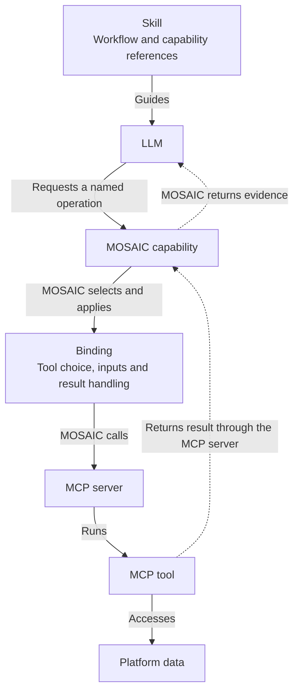

# MOSAIC Platform Adoption Guide

## Introduction

Use this guide to onboard a platform into MOSAIC, from gathering requirements to opening production access. Start by recording who needs the data, what they need to achieve and what they may access.

Use one Jira epic per platform onboarding. For a workflow spanning platforms, track the combined outcome in the lead platform’s epic and link work owned by the other platforms.

| Role | Responsibility |
|---|---|
| Platform Ops Manager | Gathers and validates the platform requirements with tenants and other intended users. |
| Platform operations or engineering | Owns both Skill files, chooses required and optional capabilities, and validates the tested workflow. |
| Platform Owner | Approves scope and access boundaries. Signs off that the tested Skill meets the platform requirements. |
| AI Factory | Evaluates and deploys MCP tools, builds and verifies capabilities, and shares them with the platform team. Tests and packages the release with the platform team. |
| MOSAIC Ops | Receives the signed-off release, promotes it, verifies production readiness, opens access and owns rollback. |

### Terms used in this guide

| Term | Meaning |
|---|---|
| MCP server and tool | An MCP server gives MOSAIC a way to connect to a platform. Each tool is an operation the server offers, such as looking up an incident by its reference number. |
| Capability | A named MOSAIC operation with agreed inputs, restrictions and results. |
| Binding | The mapping from a MOSAIC capability to an MCP tool, including how to pass inputs and handle results. |
| Skill | Instructions for using capabilities to answer a question or carry out a workflow. |
| Release bundle | The Skills and capabilities packaged at one identifiable revision so they can be tested, deployed and restored together. |

## Onboarding workflow

🔵 **Platform Ops Manager** · 🟣 **AI Factory** · 🔴 **Platform operations or engineering** · 🟠 **Platform Owner** · 🟢 **MOSAIC Ops**

```mermaid
flowchart TD
    A["1. Gather platform requirements"]
    B["2. Evaluate MCP servers and shortlist tools<br/>Check cross-platform dependencies and service account permissions"]
    C{"Approve initial scope and access boundaries"}
    D["3. Build or extend if needed, then deploy and verify MCP tools"]
    E["4a. Build and share verified MOSAIC capabilities"]
    ES["4b. Write Skill instructions and configure capabilities"]
    F["5. Bundle the release and test end to end in development"]
    G{"Sign off on the tested outcomes"}
    H["6. Hand over the tested release and evidence"]
    I["7. Promote the release with production configuration"]
    J{"Production workflows and access verified?"}
    K["8. Open for general use"]

    A --> B --> C
    C -->|Approved| D --> E --> ES --> F --> G
    G -->|Signed off| H
    H -->|Production handover| I --> J
    J -->|Verified| K

    classDef platformOps fill:#dbeafe,stroke:#2563eb,color:#172554
    classDef factory fill:#ede9fe,stroke:#7c3aed,color:#2e1065
    classDef platformTeam fill:#ffe4e6,stroke:#e11d48,color:#881337
    classDef platformOwner fill:#ffedd5,stroke:#c2410c,color:#431407
    classDef mosaicOps fill:#dcfce7,stroke:#15803d,color:#052e16

    class A platformOps
    class B,D,E,F,H factory
    class ES platformTeam
    class C,G platformOwner
    class I,J,K mosaicOps
```



If scope or development sign-off is withheld, the AI Factory resolves the findings with the Platform Owner. If production verification fails, MOSAIC Ops holds general access and follows the rollback plan for any activated release.

### Workflows that use more than one platform

Record the expected outcome, the evidence needed and any known sources in the platform requirements. During MCP evaluation, the AI Factory confirms the sources, how their records match and what access each requires.

| What the AI Factory finds | What to do |
|---|---|
| An existing integration supplies the needed data | Reuse it and verify that the data and access are suitable for this workflow. |
| An existing integration needs a change | Agree the change with its owner and link a story for the missing tool, data or access. |
| A platform has yet to be onboarded | Start a linked onboarding workflow with that platform’s owner. Continue work that can proceed independently. |

For example, a Skill can look up an incident in ServiceNow and check a separate deployment system for recent releases to the affected service. Verify how the service is identified in each system and how far back to look. The Skill should explain if deployment data is unavailable and distinguish a release around the time of the incident from a confirmed cause.

Each source owner confirms its access boundaries. The lead Platform Owner signs off on the combined workflow and agrees which gaps can wait.

### How MOSAIC capabilities work

A **capability** is defined in MOSAIC. It gives Skills a stable name for an operation, such as “look up an incident”, and defines what information can go in and what evidence can come back. A **Skill** provides the workflow instructions and declares the capabilities it requires or can use when available. The **large language model (LLM)** follows those instructions, asks MOSAIC to run an available capability and uses the returned evidence to answer the user.



This lets several Skills reuse the same operation and lets MOSAIC choose among eligible bindings for different targets. A general-purpose MCP tool can also support several narrower capabilities, each with its own inputs, restrictions and results. The MCP server and the platform enforce access to the underlying data.

For example, an incident lookup capability could use a general-purpose record search tool. Its binding would require a valid incident reference, limit the search to incident records and return the current status and assigned team from ServiceNow.

#### Capability naming convention

Use `domain.resource[.facet].action`. The domain is the functional area, the resource is what the operation works on, the optional facet narrows its purpose, and the action describes what it does. Use lowercase letters and digits separated by dots, and start the name with a letter.

For example, `itsm.incident.status.read` reads the status and assigned team for one incident, while `deployment.release.list` lists releases. Use the same action for the same kind of operation, such as `read` for a lookup, `list` for a collection and `count` for a total. Choose names that describe the operation independently of the MCP tool, endpoint and environment. Check the catalogue for an existing capability with the same inputs, restrictions and result before proposing a new name. Keep names stable once Skills reference them.

#### What capabilities can control

Use this reference when shortlisting tools and designing capabilities.

| Control | What MOSAIC can do |
|---|---|
| Name and purpose | Give the operation a stable name in the form `domain.resource[.facet].action`, such as `itsm.incident.status.read`. Add a short description of what it does. Skills reference the capability by name. |
| Tool choice and preference | Bind the operation to an exact tool name and provider type. When several bindings are eligible for the target, use their configured priority to select one. |
| Read-only classification | Declare whether each binding reads data or can change it. MOSAIC blocks bindings marked as able to change data by default. Verify what the tool actually does, including under the allowed arguments. |
| Exposed inputs | Choose which named inputs a Skill can supply and map them to the tool’s arguments. Require inputs needed to run the tool and omit optional arguments when their inputs are missing. Unmapped inputs are ignored. |
| Fixed arguments | Supply a value that a caller cannot override, such as limiting a record search to incidents. |
| Built arguments | Combine named inputs with fixed text to form one tool argument, such as a restricted query or filter. |
| Input validation | Require a text input to match a pattern in full before calling the tool, for example to check the format of an incident reference. |
| Result source | Use the tool’s structured result or select a particular text block. Read that block as plain text, JSON or YAML, according to what the tool returns. |
| Result selection and counting | Return one value or section of the result, or count the entries in a selected list or object. Give the returned value a clear name and include selected tool arguments as context, such as the incident reference that was looked up. |
| Result limits | When reshaping a result, set a maximum response length and a maximum number of entries in the selected collection. Oversized results are rejected. When no reshaping is configured, a successful tool result is passed through as returned by the provider. |

| Shared provider or runtime control | What MOSAIC can do |
|---|---|
| Endpoint and tools | Configure a named MCP provider, its Streamable HTTP endpoint and its exact list of callable tools. The current integration uses ADA’s request-context headers. |
| Targets and routing | Give each target a stable ID, display name and aliases. A provider can serve requests without a target, have one endpoint per target, or use a shared endpoint. With a shared endpoint, MOSAIC supplies a protected tool argument from the configured target mapping. |
| Runtime limits | Apply a shared execution timeout and ceilings for capability result limits. Capability discovery returns a limit error if there are too many eligible capabilities or too much metadata to present to the model. |

For each approved capability, record the inputs, fixed restrictions, returned evidence and access checks in the Capability build inventory. The mechanism for authoring and validating capability definitions is a separate MOSAIC activity.

### How to write and package Skills

The AI Factory shares the verified Capability build inventory with platform operations or engineering. It shows which capabilities are available, what inputs they accept and what evidence they return.

Platform operations or engineering owns both files for each Skill. In `SKILL.md`, it defines the workflow, what evidence to report and how to handle missing data or denied access. In `mosaic.yaml`, it lists the exact capability IDs and marks each as required or optional for that Skill. The AI Factory and platform team test the packaged Skill in MOSAIC, and the Platform Owner signs off on the tested outcome.

#### Directory layout

Put each Skill in the catalogue repository under `skills/<domain>/<function>/<skill-name>/`. Use exactly those three levels beneath `skills/`. Use lowercase letters, digits and single hyphens for directory names. The final directory must match the Skill’s `name`, which must be unique across the catalogue. Domain and function group Skills for browsing.

```text
skills/
└── itsm/
    └── incidents/
        └── check-incident-progress/
            ├── SKILL.md
            └── mosaic.yaml
```

Both files are mandatory and sit in the same directory. Optional `references/` and `assets/` folders can hold supporting guidance, templates and schemas. Keep file references relative to and inside the Skill directory. The pilot does not run contributed scripts.

#### `SKILL.md` · discovery and workflow instructions

Start with **YAML frontmatter**, the header between two `---` lines. The required fields are `name` (1–64 characters) and `description` (1–1,024 characters). The description explains what the Skill does and when to use it. Optional fields include `license`, `compatibility` and `metadata` with string values. The `allowed-tools` field grants no access in MOSAIC. Declare capability access in `mosaic.yaml`.

Follow the header with non-empty Markdown instructions. For W1, the file could read as follows.

```markdown
---
name: check-incident-progress
description: >-
  Check the status and assigned team of a ServiceNow incident.
  Use when a user asks who is handling an incident or how it is progressing.
---

# Check incident progress

1. Ask for the incident reference if it is missing.
2. Use `itsm.incident.status.read` to look up the exact reference.
3. Report the status and assigned team from the result.
4. If the lookup cannot return details, tell the user what can be verified.
```

#### `mosaic.yaml` · version and capability requirements

```yaml
schema_version: 1
version: 1.0.0
kind: procedural
required_capability_names:
  - itsm.incident.status.read
optional_capability_names: []
```

| Field | What to put in it |
|---|---|
| `schema_version` | Use `1`, the supported format version. MOSAIC defaults to `1` if omitted. |
| `version` | Required Skill version in Semantic Versioning format, such as `1.0.0`. Bump it when changing a published Skill. |
| `kind` | Required. Use `procedural` for workflows. Use `output` to guide how existing evidence is presented. Output Skills have empty capability lists. |
| `required_capability_names` | Capabilities the Skill needs to deliver its minimum outcome. |
| `optional_capability_names` | Capabilities that add useful evidence when available. The workflow still works without them. Both lists default to empty. Use exact MOSAIC capability names, with no duplicates within or across lists. |
| `output_form_file`, `output_schema_file` | Optional paths within the package. Use a Markdown file for a response form or a JSON Schema file for structured output. |

Before handover, validate that the catalogue loads the package, capability names resolve for the tested release, and the Skill handles normal, missing-data and denied-access cases as intended.

### MCP service account access

Each MCP server needs a service account to access the platform data its tools use. During evaluation, the AI Factory maps the shortlisted tools to the operations and data they need, then works with each relevant Platform Owner to request a service account with only those permissions. Where different tools need different access, agree which tools each account will serve.

Before handover, test the deployed tools with the assigned account. Verify that they can perform the agreed operations on the required data and that requests outside the account’s approved scope are denied. Record the account owner, approved permissions and the credential configuration reference. The MCP server must also enforce the caller’s own access under the authorisation requirements below.

### MCP server RBAC requirement

Role-based access control (RBAC) limits what users can do and which resources they can access. The Platform Owner defines the policy. The AI Factory and service owner verify enforcement where the tool accesses platform data.

The **MOSAIC-to-MCP authorisation contract is open**. The MOSAIC team, platform security and service owners must agree what MOSAIC sends and how the server verifies and uses it. Use the MOSAIC-to-MCP authorisation decision record below.

Evaluation may proceed with agreed test access. Before general production access, MOSAIC Ops needs evidence that the implemented contract permits representative in-scope requests and denies out-of-scope requests and invalid authorisation context.

## Per-platform Jira story skeletons

Replace `<platform>` in each title and link the preceding story and its evidence. For each story, the **Done when** column can serve as the acceptance criteria.

| Story title | Owner | Done when | Evidence to link |
|---|---|---|---|
| Gather MOSAIC requirements for `<platform>` | Platform Ops Manager | Audience representatives validate the workflows, smallest useful outcomes and access boundaries. | Platform requirements |
| Evaluate MCP servers and shortlist tools for `<platform>` | AI Factory | Test candidate tools, link dependencies and request service account access. Record the Platform Owner’s scope decision and finalise the capability build list against verified tool contracts. | Evaluation and scope decision, capability build list, access requests |
| Build or extend the MCP server for `<platform>` | AI Factory, where required | The agreed tools return the required data with representative access. Record results for allowed and denied requests under the agreed test policy. | Evaluation and scope decision, tool test evidence |
| Deploy and document the MCP server for `<platform>` | AI Factory | A named operational owner is recorded. MOSAIC can connect and authenticate. The deployed tools can access the agreed data with the assigned service account, and requests outside its approved scope are denied. | MCP deployment and tool handover |
| Integrate MCP capabilities for `<platform>` | AI Factory | Build and verify the approved bindings. Share the verified capability IDs, inputs and outputs with the platform team. | Capability build inventory, development test evidence |
| Write and configure Skills for `<platform>` | Platform operations or engineering | Write `SKILL.md` and `mosaic.yaml` for each agreed workflow. Choose required and optional capabilities from the verified inventory. | `SKILL.md` and `mosaic.yaml` files |
| Test and hand over the MOSAIC release for `<platform>` | AI Factory, with platform operations or engineering | Test workflows and access in development. The Platform Owner signs off and MOSAIC Ops receives the bundle and evidence. | Development test and handover record |
| Promote and open MOSAIC access for `<platform>` | MOSAIC Ops | The signed-off revision is active with production configuration. Production workflow and access checks pass, and general access is enabled. A previous revision or first-release recovery action is recorded. | Production release record |

## Delivery templates

Use one copy of `MOSAIC_Platform_Onboarding.xlsx` per platform and link it from the Jira epic. **For reference, the Excel workbook contains a ServiceNow example populated across all eight tabs.** Use it to see how the records link across the onboarding sequence, then replace the shaded example rows in your copy.

Reuse workflow IDs across tabs and link existing evidence, approvals and access requests. Use sanitised test results and approved credential references.

### Platform requirements

The **Platform Ops Manager** records one row per workflow, validated with intended users. Capture the workflow ID, audience, task, minimum useful outcome and access boundary. Example questions and useful additions are optional.

### Tool evaluation

The **AI Factory** records the exact MCP server and tool, the result or gap, and the access check. Use the same workflow ID for all tools that support a use case. If tools need to work together, record how their inputs or results match and link the combined test.

### Scope decision

The **AI Factory** recommends which server and tools to reuse, extend or build and which workflows to include. The **Platform Owner** records the decision. Mark each workflow **Covered**, **Partial** or **Open**. Mark it covered when testing shows that all required tools deliver the minimum outcome within the agreed access boundaries. Link the evidence and assign any follow-up.

Record service account approvals in the existing access request, including the environment, tools, operations, data scope and approving Platform Owner.

### MCP handover

The **AI Factory** records the deployed version, configuration reference, support owner and evidence that the service account can perform the agreed operations and is denied access outside scope. Link the existing runbook where available.

### MCP authorisation

The **MOSAIC team** owns the central authorisation decision. It covers what caller information is passed, how the server verifies it, and how the server enforces and audits access. The **AI Factory** links the applicable decision and records any platform-specific exceptions and enforcement evidence. Use the agreed caller authorisation checks before opening production access.

### Capability build inventory

The **AI Factory** records one row per capability approved for build. Capture the exact capability ID, MCP server and tool, inputs, restrictions, output mapping and checks. Link the workflow and verified tool evidence. Share the verified inventory with platform operations or engineering for Skill authoring.

### Development handover

The **AI Factory** and **platform operations or engineering** record the tested bundle and end-to-end results, including access checks. For workflows that combine sources, cover a successful match, a missing or ambiguous match, and restricted access to one source. Link any follow-up, **Platform Owner** sign-off and **MOSAIC Ops** receipt.

### Production release

**MOSAIC Ops** records the released revision, production configuration reference, verification evidence, recovery action and decision to open access. Verify a representative workflow and its access boundary before opening access. Use the existing release ticket for approvals and evidence where available.
